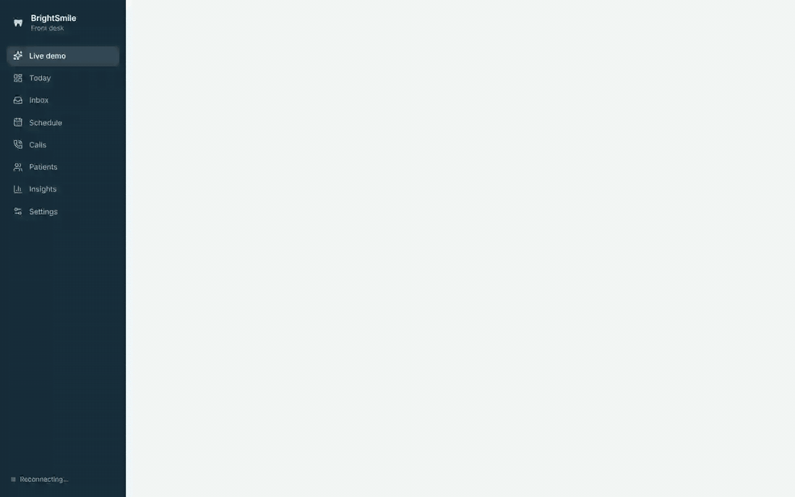
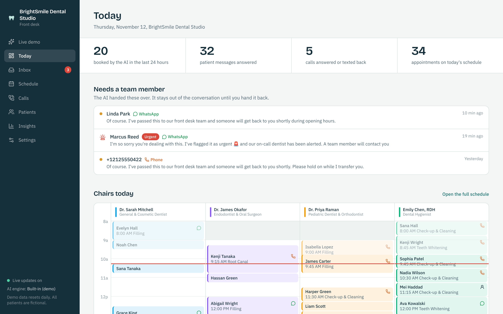
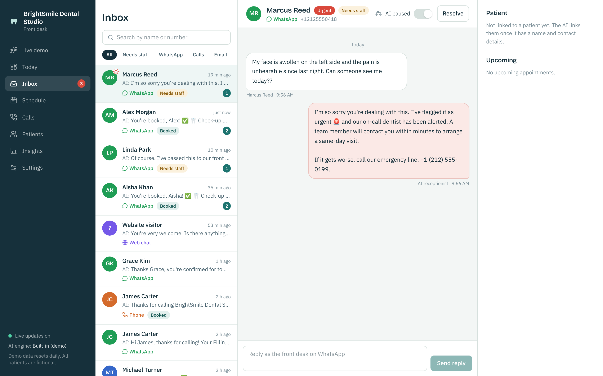
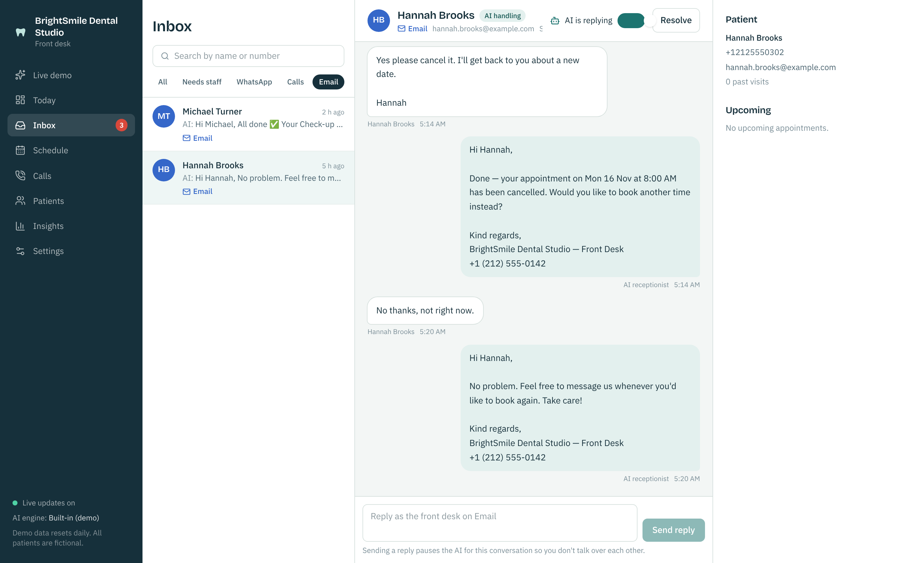
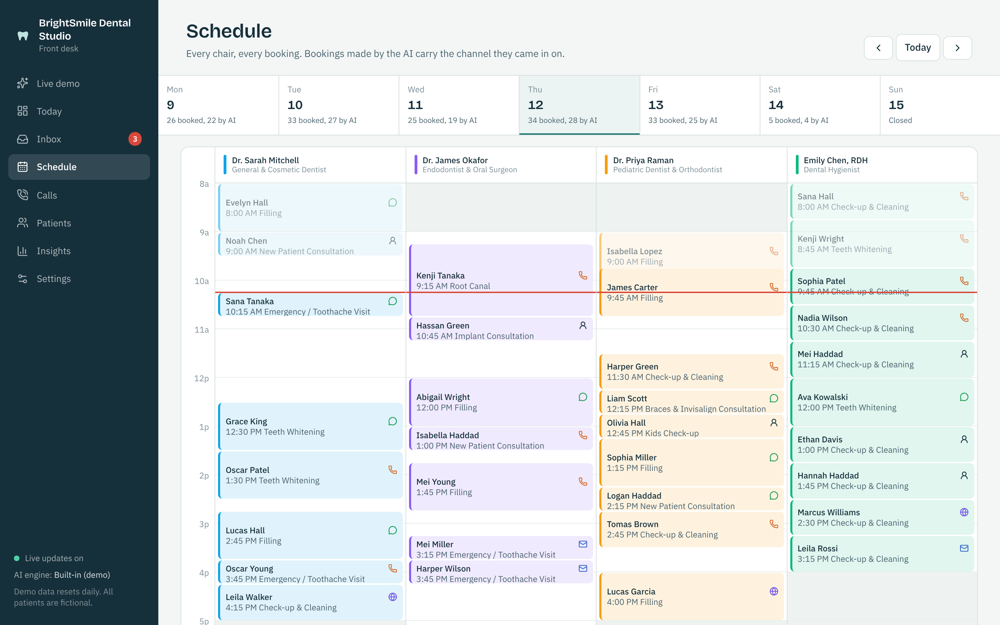
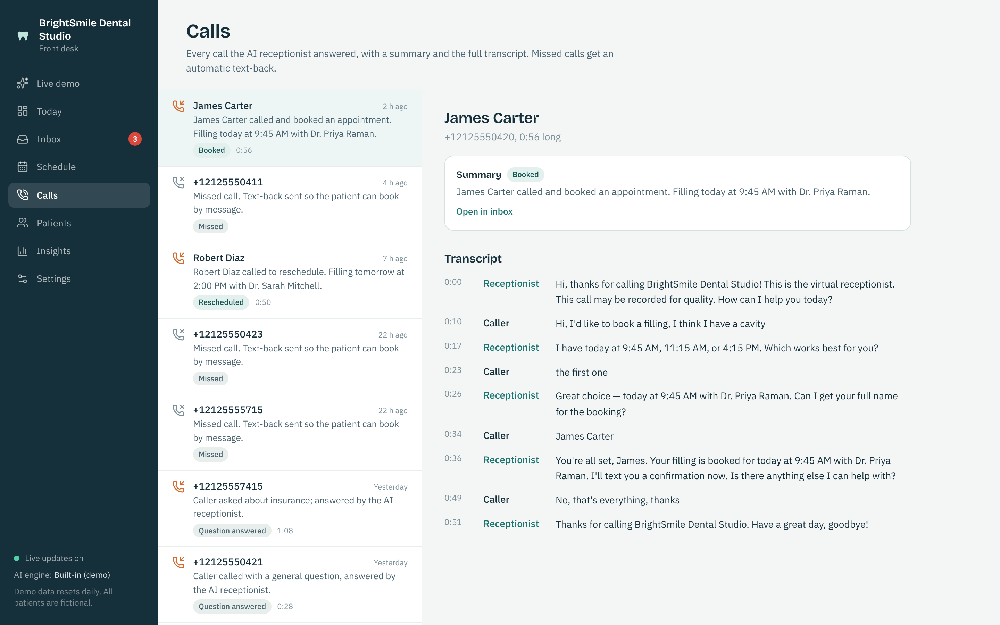
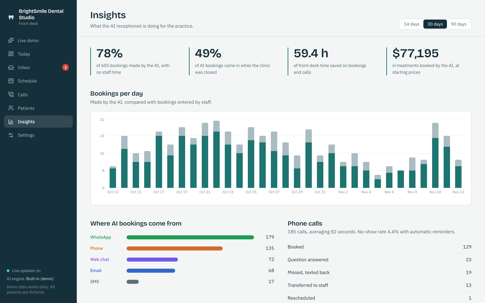
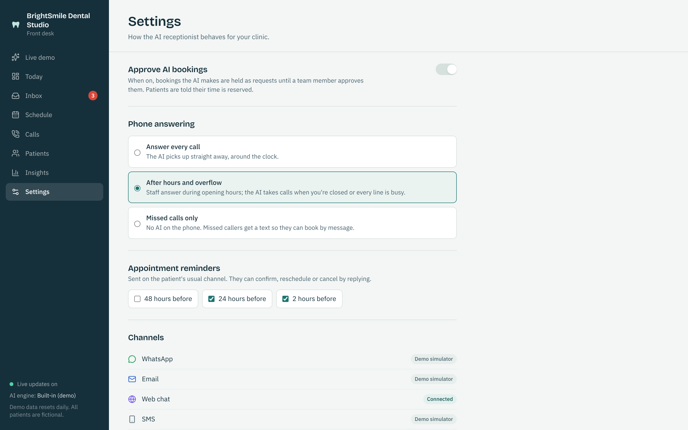
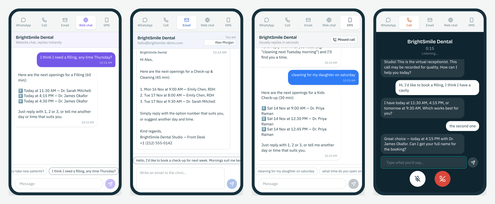
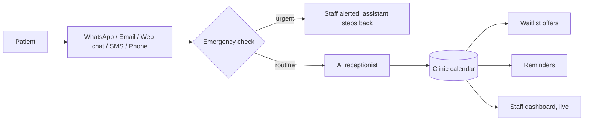

# AI Receptionist for Dental Clinics

**An AI front desk that answers patients on WhatsApp, email, website chat, SMS and the phone, and books them straight into the clinic's calendar, 24/7.**

*Above: a patient asks for a cleaning on WhatsApp. The assistant checks the real calendar, offers three times, books the one they pick, and the appointment appears on the clinic's schedule immediately.*

---

## The problem

A dental front desk spends much of its day on the phone and in the inbox: booking, moving and confirming appointments, and answering the same questions about prices, insurance and opening hours. Messages that arrive in the evening wait until morning. Calls during busy hours go to voicemail. Every unanswered patient is a booking that might go to another clinic.

## What this does

- **Answers on every channel.** WhatsApp, email, website chat, SMS and phone calls all go to the same assistant, with the same rules and the same calendar.
- **Books real appointments.** It knows each dentist's working days, each treatment's length and the clinic's opening hours, and never double-books. Patients can say "a cleaning tomorrow morning" or "Friday after 4" and get three real options.
- **Reschedules and cancels by message.** When someone cancels, the freed time is offered to the next patient on the **waitlist** automatically.
- **Sends reminders.** 24 hours and 2 hours before each visit. Patients reply "YES" to confirm, or ask to move the appointment.
- **Answers questions.** Prices, insurance, location, parking and new-patient information, in the clinic's own words.
- **Recognises emergencies.** Swelling, uncontrolled bleeding, a knocked-out tooth or fever are flagged as urgent, the on-call dentist is alerted, and the patient gets the emergency line. The assistant never gives medical advice.
- **Answers the phone.** A natural-sounding voice receptionist books calls the same way, transfers to a person when asked, texts a confirmation afterwards and saves a summary and transcript. **Missed calls get an automatic text** inviting the patient to book by message.
- **Keeps staff in control.** Staff can take over any conversation with one click; the assistant steps back until it's handed back. An optional mode holds every AI booking for approval.

## The staff dashboard

**Today:** what needs a person, every chair's schedule and a live log of what the assistant did.

**Inbox:** every channel in one place. Urgent cases go to the top, with the patient's details and upcoming visits alongside.

**Email cancellation, handled end to end:** the assistant confirms, cancels, offers to rebook, and the freed slot goes to the waitlist.

**Schedule:** one column per dentist. Each AI booking shows the channel it came from.

**Calls:** every call with an outcome, summary and full transcript.

**Insights:** how many bookings the assistant made, how many arrived while the clinic was closed, and the front-desk time it saved.

**Settings:** approval mode, phone answering mode (every call, after hours only, or missed calls only) and reminder timing.

## What patients see

Website chat, email, SMS after a missed call, and a phone call:

## How it works

- The AI can only act through a small set of booking tools, limited to the patient it's talking to. It can't see or change anyone else's appointments, whatever a message says.
- If the AI service is ever unavailable, a built-in engine keeps answering, so patients are never left without a reply.
- Every webhook from WhatsApp, Twilio and the phone platform is signature-checked.

## Built with

Python (FastAPI, SQLAlchemy), Claude by Anthropic (tool use), React + TypeScript + Tailwind, WhatsApp Cloud API, Twilio, Vapi (voice), Docker. Covered by 79 automated tests, including the full demo story replayed on every day of the week.

## Setting it up for a clinic

1. Add your dentists, working hours, treatments and prices, and your answers to common questions.
2. Connect the channels you use: your WhatsApp Business number, your clinic inbox, a website chat snippet and your phone line.
3. Choose how hands-on you want to be: approve every booking, or let the assistant book directly.
4. Go live. Your team works from the dashboard, and the assistant handles the rest.

## Try it or see the code

- **Live demo:** a fictional clinic you can message and call yourself. Ask me for the link.
- **Source code:** kept private. I'm happy to walk you through it on a call or give a client read access for review.

---

© 2026 Muzamil. All rights reserved. The demo clinic, staff and patients are fictional.
